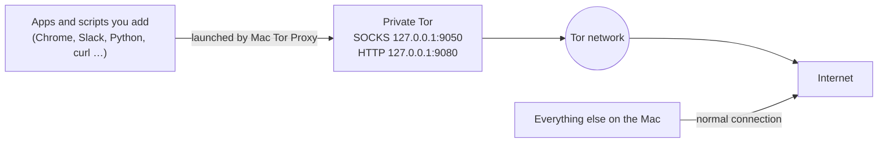

# Mac Tor Proxy

**Route only the apps you choose through Tor on macOS.** Mac Tor Proxy runs its own private Tor proxy and gives you a small menu bar app to pick applications, scripts and commands to send through it, and to turn Tor on and off. Everything you don't launch from it keeps using your normal connection.

- One-click **Start / Stop Tor**, with live connection progress
- Add apps by picking them or dragging them in; the right way to proxy each one is detected automatically
- Browsers open in a **separate Tor-only profile** next to your normal one
- Scripts and commands run in Terminal or in the background with Tor settings applied
- **Check exit IP** and **New identity** buttons
- A `torrun` command for the Terminal: `torrun curl https://check.torproject.org/api/ip`



---

## Contents

- [Requirements](#requirements)
- [Install](#install)
- [Quick start](#quick-start)
- [How each kind of app is routed](#how-each-kind-of-app-is-routed)
- [The menu bar icon](#the-menu-bar-icon)
- [Command line: torrun](#command-line-torrun)
- [Checking that it works](#checking-that-it-works)
- [Settings and files](#settings-and-files)
- [Updating](#updating)
- [Troubleshooting](#troubleshooting)
- [Limitations and privacy notes](#limitations-and-privacy-notes)
- [Uninstall](#uninstall)
- [Development](#development)
- [License](#license)

---

## Requirements

- macOS 13 Ventura or later. Built for Apple Silicon; Intel Macs should work but haven't been tested.
- [Homebrew](https://brew.sh)
- About 400 MB of disk space, mostly for the Qt GUI libraries

The installer takes care of everything else: [Tor](https://www.torproject.org), [proxychains-ng](https://github.com/rofl0r/proxychains-ng), Python 3.13 and [PySide6](https://doc.qt.io/qtforpython-6/).

## Install

Clone the repository and run the installer:

```bash
git clone https://github.com/williamblake333/mac-tor-proxy.git ~/mac-tor-proxy
bash ~/mac-tor-proxy/install-mac-tor-proxy.sh
```

If the repository is public, you can also install with one line, without cloning:

```bash
curl -fsSL https://raw.githubusercontent.com/williamblake333/mac-tor-proxy/main/install-mac-tor-proxy.sh | bash
```

The installer:

1. Installs `tor`, `proxychains-ng` and `python@3.13` with Homebrew (anything already installed is skipped).
2. Creates a private Python environment in `~/.mac-tor-proxy/venv` with PySide6.
3. Installs the app to `~/Applications/Mac Tor Proxy.app` and opens it.
4. Adds `~/.mac-tor-proxy/bin` to your `PATH` in `~/.zshrc` so the `torrun` command works in new Terminal windows.

Apart from the Homebrew packages, everything stays in your home folder, and no administrator password is needed.

## Quick start

1. Open **Mac Tor Proxy** from `~/Applications` (or Spotlight). An onion icon appears in the menu bar.
2. Click **Start Tor**. The dot turns green when Tor reaches 100%, usually within 10 to 30 seconds.
3. Add what you want routed through Tor:
   - **Add App…** for anything in `/Applications`
   - **Add Script…** for a `.py`, `.sh`, `.js` or any executable
   - **Add Command…** for a one-line command, for example `curl https://check.torproject.org/api/ip`
   - or drag `.app` bundles and scripts onto the window
4. Select a row and click **Launch through Tor**.

If Tor isn't running when you launch something, Mac Tor Proxy starts it and launches the app as soon as Tor is connected. You can turn that off in the options row.

Each row has these columns:

| Column | What it does |
|---|---|
| **Name** | Double-click to rename. The name also appears in the menu bar's launch list. |
| **Route method** | How the app is sent through Tor (see the next section). Detected automatically; change it if needed. |
| **Extra args** | Extra command-line arguments passed to the app or script. |
| **Terminal** | Scripts and commands only. Checked: run in a new Terminal window. Unchecked: run in the background and write output to `~/.mac-tor-proxy/logs/`. |
| **Path / command** | The app or script path, or the command text (editable for commands). |

Right-click a row for **Launch through Tor**, **Show in Finder**, **Open background output log** and **Remove**.

## How each kind of app is routed

macOS has no built-in way to send one app's traffic through a proxy, so Mac Tor Proxy launches each app in a way that makes it use Tor. The method is picked automatically when you add something.

| Route method | Used for | How it works |
|---|---|---|
| **Chromium flags + own profile** | Chrome, Brave, Edge, Vivaldi, Opera, Chromium | Starts a separate copy of the browser with `--proxy-server` and DNS-through-Tor flags, WebRTC leak protection and its own profile in `~/.mac-tor-proxy/profiles/`. Your normal browser window and profile are untouched. |
| **Firefox Tor profile** | Firefox, LibreWolf, Waterfox, Zen, Floorp | Starts the browser with a dedicated profile set to Tor's SOCKS proxy with remote DNS, WebRTC off and DNS-over-HTTPS off. |
| **Electron proxy flags** | Slack, Discord, VS Code, Obsidian, Notion and other Electron apps | Passes Chromium proxy flags to the app. **Quit the app first**: the flags only apply to a fresh launch. |
| **Proxy env vars** | curl, git, pip, Python `requests`, Go programs, Node 24+ | Sets `ALL_PROXY`, `HTTP_PROXY`, `HTTPS_PROXY` and friends. Works only for programs that honor these variables. |
| **proxychains (forced)** | Homebrew-installed or self-built programs and scripts | Uses proxychains-ng to force every TCP connection through Tor, even for programs that ignore proxy settings. macOS blocks this for Apple's own `/usr/bin` tools and for signed apps. |
| **Tor Browser (own Tor)** | Tor Browser | Just opens it. Tor Browser has its own built-in Tor. |

**Fail-closed:** browsers, Electron apps and proxychains-launched programs can't connect at all while Tor is off, so they never silently fall back to your normal connection. Programs using proxy env vars generally fail closed too, but a program that ignores those variables connects directly.

Native macOS apps (Mail, Messages, most App Store apps) usually ignore all of these. They are added with **Proxy env vars** and a warning; see [Limitations](#limitations-and-privacy-notes).

### Proxy settings used

| Variable | Value |
|---|---|
| `ALL_PROXY`, `HTTP_PROXY` | `socks5h://127.0.0.1:9050` (the `h` means DNS is resolved through Tor) |
| `HTTPS_PROXY` | `http://127.0.0.1:9080` (Tor's HTTP CONNECT tunnel, understood by almost every tool) |
| `NO_PROXY` | `localhost,127.0.0.1,::1` |
| `NODE_USE_ENV_PROXY` | `1` (makes Node 24+ use the proxy variables) |
| `MAC_TOR_PROXY` | `1` (lets your own scripts detect they were launched through Tor) |

Lowercase versions of the proxy variables are set too.

## The menu bar icon

The onion icon's color shows Tor's status:

| Color | Meaning |
|---|---|
| Green | Tor is connected |
| Amber | Tor is starting or connecting |
| Blue | Another program is already using the SOCKS port (for example Homebrew's Tor service); Mac Tor Proxy can't control it |
| Gray | Tor is stopped |

Its menu has **Start/Stop Tor**, **New identity**, a **Launch through Tor** list of everything you added, **Open Tor Terminal**, **Show Mac Tor Proxy** and **Quit Mac Tor Proxy**.

Closing the window keeps Mac Tor Proxy running in the menu bar. Quit from the menu bar icon. Opening the app again while it's running brings its window back.

## Command line: torrun

`torrun` runs a single command through Mac Tor Proxy's Tor. Start Tor in the app first.

```bash
# Proxy env vars (for proxy-aware tools)
torrun curl https://check.torproject.org/api/ip
torrun git clone https://github.com/torproject/tor.git
torrun python3 ~/Desktop/fetch_prices.py

# Force everything through Tor with proxychains (Homebrew-installed programs)
torrun -p python3 ~/Desktop/fetch_prices.py
torrun -p /opt/homebrew/opt/curl/bin/curl https://check.torproject.org/api/ip
```

**Open Tor Terminal** (in the window or menu bar) opens a Terminal window with the proxy variables already set, so every proxy-aware command you run there uses Tor.

## Checking that it works

- **Check exit IP** in the window asks `check.torproject.org` through Tor and shows the exit IP address.
- In a browser launched through Tor, open <https://check.torproject.org>. It should say you're using Tor.
- In the Terminal:

  ```bash
  torrun curl https://check.torproject.org/api/ip
  # {"IsTor":true,"IP":"185.220.101.4"}
  ```

- To confirm something is **not** using Tor, run the same command without `torrun`; it should report `"IsTor":false`.

## Settings and files

Everything lives in `~/.mac-tor-proxy`:

| Path | Contents |
|---|---|
| `config.json` | Your app list and settings |
| `torrc` | Tor configuration, rewritten every time Tor starts |
| `tor-data/` | Tor's state and the control-port cookie |
| `tor.log` | Tor's log |
| `mac-tor-proxy.log` | The app's own log (check here if the window doesn't open) |
| `profiles/` | Separate browser profiles used for Tor launches |
| `logs/` | Output from scripts and commands run in the background |
| `proxychains.conf` | Used by the proxychains route method |
| `bin/torrun` | The `torrun` command |
| `venv/` | The private Python environment |

The window has controls for every setting. If you edit `config.json` by hand, quit Mac Tor Proxy first.

| Setting | Default | Meaning |
|---|---|---|
| `socks_port` | `9050` | Tor SOCKS port |
| `http_tunnel_port` | `9080` | Tor HTTP CONNECT port, used for `HTTPS_PROXY` |
| `control_port` | `9051` | Tor control port (cookie-authenticated, local only) |
| `start_tor_on_open` | `false` | Start Tor whenever Mac Tor Proxy opens |
| `autostart_on_launch` | `true` | Start Tor automatically when you launch something while it's off |
| `stop_tor_on_quit` | `true` | Stop Tor when you quit Mac Tor Proxy |

Ports can only be changed while Tor is stopped. All ports listen on `127.0.0.1` only, so nothing is reachable from your network.

To start Mac Tor Proxy at login, add it under **System Settings → General → Login Items**.

## Updating

```bash
cd ~/mac-tor-proxy && git pull
bash install-mac-tor-proxy.sh
```

Your app list, settings and browser profiles are kept.

## Troubleshooting

**"Port 9050 is already in use"**
Something else is listening on Tor's port, usually Homebrew's Tor service. Stop it with `brew services stop tor`, or change the ports in Mac Tor Proxy.

**Tor stays amber and never reaches 100%**
Check `~/.mac-tor-proxy/tor.log`. Networks that block Tor need bridges, which this version doesn't configure. A VPN that blocks Tor traffic causes the same symptom.

**An Electron app opens but isn't using Tor**
It was already running, so it ignored the new flags. Quit it completely (⌘Q) and launch it again from Mac Tor Proxy. The app warns you about this when it can tell.

**A browser opens without my bookmarks or logins**
That's intended: Tor launches use a separate profile so your normal browsing stays separate. Sign in again inside the Tor profile if you need to.

**Nothing happens when launching a script in Terminal**
The first time, macOS asks whether **Python** (Mac Tor Proxy) may control Terminal. If you clicked *Don't Allow*, turn it back on under **System Settings → Privacy & Security → Automation**.

**The Dock and menu bar show "Python"**
The app runs on Python, so macOS shows Python's name. This is only cosmetic.

**proxychains says nothing or the program still connects directly**
macOS (System Integrity Protection) strips proxychains from Apple-signed programs such as `/usr/bin/curl`, `/usr/bin/python3` and `/bin/zsh`. Use Homebrew versions instead: `brew install curl` and `/opt/homebrew/opt/curl/bin/curl`, or `/opt/homebrew/bin/python3`.

**A Python script fails with "Missing dependencies for SOCKS support"**
That happens for plain `http://` URLs with `requests`. Install SOCKS support in that script's environment: `pip install "requests[socks]"`. HTTPS URLs work without it.

**The window won't open**
Look at the end of `~/.mac-tor-proxy/mac-tor-proxy.log`, or run it from the Terminal to see errors directly:

```bash
~/.mac-tor-proxy/venv/bin/python ~/.mac-tor-proxy/mac_tor_proxy.py
```

## Limitations and privacy notes

- **Only apps launched from Mac Tor Proxy use Tor.** It is not a system-wide VPN and has no kill switch for the rest of the Mac.
- **Native macOS apps usually can't be routed.** Apps built on Apple's networking frameworks ignore proxy variables, and macOS blocks proxychains for signed apps. To force those through Tor you need a per-app proxy tool such as [Proxifier](https://www.proxifier.com) (paid).
- **A normal browser over Tor hides your IP address but is not anonymous.** Chrome and Firefox can still be fingerprinted, and signing in to accounts identifies you. For anonymous browsing, use [Tor Browser](https://www.torproject.org/download/).
- **Proxy env vars are a request, not a guarantee.** A program that ignores them connects directly. Use proxychains, or verify with the checks above, when it matters.
- **UDP isn't carried by Tor.** Voice and video calls, QUIC and other UDP traffic won't work through it (QUIC is disabled in Chromium launches for that reason).
- **Not affiliated with the Tor Project.** Mac Tor Proxy is an independent helper that runs the official `tor` from Homebrew.

## Uninstall

```bash
bash ~/mac-tor-proxy/install-mac-tor-proxy.sh --uninstall
```

This stops Mac Tor Proxy and its Tor instance and removes `~/.mac-tor-proxy`, `~/Applications/Mac Tor Proxy.app` and the `PATH` line in `~/.zshrc`. Homebrew packages are left in place; remove them with `brew uninstall tor proxychains-ng` if you don't need them.

## Development

```
mac-tor-proxy/
├── mac_tor_proxy.py          The app: Tor management, launching, and the Qt GUI
├── install-mac-tor-proxy.sh  Installer, updater and uninstaller
├── LICENSE                   GNU GPL v3.0
└── tests/
    ├── test_mac_tor_proxy.py  Tor control protocol, launch commands, config, GUI flow
    ├── test_installer.sh      Dry-runs the installer in a throwaway $HOME
    └── qt_stub/               Minimal PySide6 stand-in so tests run without Qt
```

Run the tests (no Tor, Qt or Homebrew needed; works on macOS and Linux):

```bash
python3 tests/test_mac_tor_proxy.py
bash tests/test_installer.sh
```

The Python tests talk to a fake Tor control port, record the exact `open`, `osascript` and `proxychains4` commands each route method produces, and drive the GUI logic through the Qt stub. The installer test runs the real installer with stand-ins for `brew`, `pip`, `open` and `curl`.

To run the app from a checkout while developing:

```bash
~/.mac-tor-proxy/venv/bin/python mac_tor_proxy.py
```

Set `MAC_TOR_PROXY_HOME` to use a different data folder than `~/.mac-tor-proxy`, which is handy for testing without touching your real settings.

## License

Mac Tor Proxy is free software under the [GNU General Public License v3.0](LICENSE). You can use, study, share and modify it; if you distribute a modified version, it must stay under the GPL with its source available.
